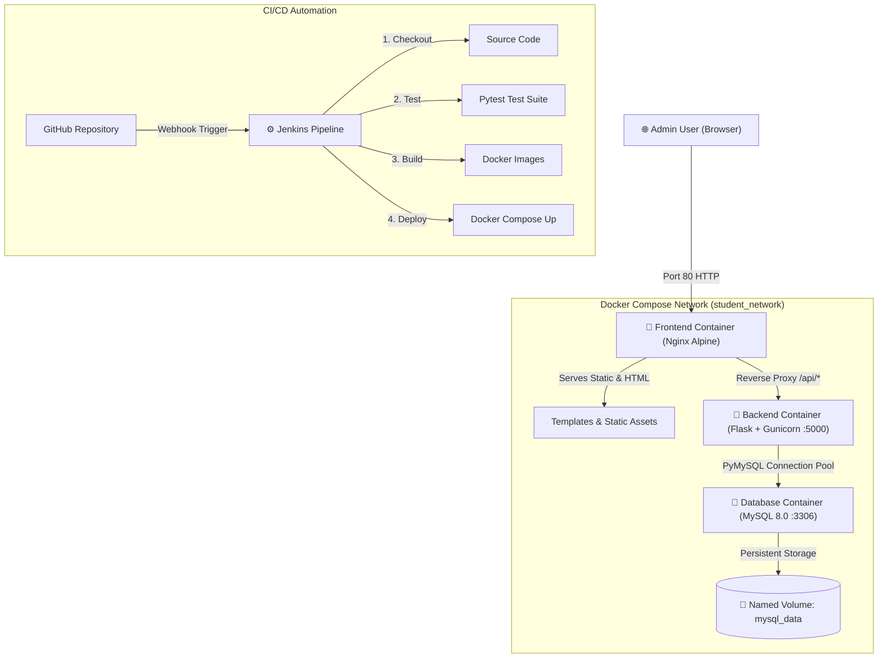

# 🎓 Student Management System with Docker & CI/CD Pipeline

A complete, modern, production-ready **Student Management System (SMS)** built with **Python Flask**, **MySQL 8.0**, **Bootstrap 5**, **Docker containerization**, and automated **Jenkins CI/CD Pipeline**.

---

## 📋 Table of Contents
1. [Project Overview](#-project-overview)
2. [Key Features](#-key-features)
3. [Technology Stack](#-technology-stack)
4. [System Architecture](#-system-architecture)
5. [Project Structure](#-project-structure)
6. [Prerequisites](#-prerequisites)
7. [Quick Start with Docker Compose](#-quick-start-with-docker-compose)
8. [Local Development (Without Docker)](#-local-development-without-docker)
9. [Automated Testing](#-automated-testing)
10. [Jenkins CI/CD Pipeline Configuration](#-jenkins-cicd-pipeline-configuration)
11. [GitHub Integration & Webhooks](#-github-integration--webhooks)
12. [AWS EC2 Deployment Guide](#-aws-ec2-deployment-guide)
13. [API Documentation](#-api-documentation)
14. [Troubleshooting Guide](#-troubleshooting-guide)
15. [License & Credits](#-license--credits)

---

## 🌟 Project Overview

The **Student Management System** is designed for educational institutions to streamline student record keeping, manage daily attendance, track academic demographics, and maintain database integrity with modern web technologies. 

Engineered with a **DevOps-first approach**, the system separates concerns across three containerized tiers:
- **Tier 1 (Presentation):** Nginx web server handling HTTP requests and reverse-proxying API traffic.
- **Tier 2 (Application):** Python Flask REST API served with Gunicorn WSGI.
- **Tier 3 (Database):** MySQL 8.0 engine persisted via Docker named volumes with health check probes.

---

## ✨ Key Features

### 🖥️ Frontend (UI & UX)
- **Modern Responsive Dashboard:** Built with Bootstrap 5, FontAwesome icons, and Google Inter typography.
- **Live Statistics Cards:** Displays **Total Students**, **Male Students**, **Female Students**, and **Today's Attendance Rate**.
- **Interactive Visualizations:** Dynamic bar charts powered by **Chart.js** displaying student distribution across engineering departments.
- **Student Management Directory:** Full CRUD operations with responsive tables, quick view, modal forms, and real-time search.
- **Multi-Field Filtering:** Filter students simultaneously by Department, Semester (1–8), Gender, and Enrollment Status.
- **Dedicated Attendance Hub:** Date-picker driven classroom roster with toggle buttons (**Present**, **Late**, **Absent**), bulk actions ("Mark All Present / Absent"), and single-click MySQL persistence.
- **Student Profile View:** Detailed student dossiers with initials avatar, contact information, circular attendance gauge, exam eligibility checks (>= 75%), and historical session logs.
- **DevOps System Status Badge:** Pulsing health indicator querying `/api/health` every 30 seconds.

### ⚙️ Backend (Flask REST API)
- **Admin Authentication:** Session-based authentication with password hashing using Werkzeug `scrypt`.
- **Student CRUD Engine:** Endpoints for creating, listing, retrieving, updating, and deleting records.
- **Search Engine:** Sub-second search across Student Name, USN, Student ID, and Email.
- **Input Validation:** Strict validation enforcing USN uniqueness, email syntax, phone format, semester bounds (1–8), and allowed status types.
- **Attendance Aggregator:** Date-based roster generation and bulk upsert operations.
- **Dual-Database Resilience:** Seamlessly uses MySQL 8.0 with automatic retry backoff, with an intelligent SQLite fallback for offline development and fast CI test runs.
- **Container Health Probes:** Exposes `/api/health` returning JSON database connectivity and service state.

### 🐳 DevOps & Containerization
- Multi-container orchestration using **Docker Compose**.
- Isolated custom bridge network (`student_network`).
- Health checks configured on all tiers with dependency ordering (`condition: service_healthy`).
- Non-root application user in `backend/Dockerfile` for security compliance.
- Nginx reverse-proxy caching and header forwarding.

---

## 🛠️ Technology Stack

| Layer | Technology | Description |
| :--- | :--- | :--- |
| **Frontend** | HTML5, CSS3, JavaScript (ES6+), Bootstrap 5.3.3 | Responsive admin dashboard with modern aesthetics |
| **Icons & Charts**| FontAwesome 6.5, Chart.js 4.4 | Vector iconography and dynamic metric charts |
| **Backend** | Python 3.12, Flask 3.0.3, Gunicorn 22.0 | RESTful API and session authorization |
| **Database** | MySQL 8.0 (PyMySQL 1.1) | Relational database with FK cascades & indexes |
| **Testing** | Pytest 8.2, Python `unittest` | 19 automated integration and unit test cases |
| **Containers** | Docker Engine & Docker Compose | Multi-container microservices architecture |
| **Web Server** | Nginx 1.27 Alpine | High-performance reverse proxy & static asset server |
| **CI/CD** | Jenkins (Declarative Pipeline) | Multi-stage build, test, and deployment automation |
| **VCS** | Git & GitHub | Version control and webhook triggers |

---

## 🏛️ System Architecture



---

## 📂 Project Structure

```text
Student-Management-DevOps/
├── frontend/
│   ├── templates/
│   │   ├── index.html            # Gateway redirector
│   │   ├── login.html            # Admin login interface
│   │   ├── dashboard.html        # Main admin metrics dashboard
│   │   ├── students.html         # Student directory with CRUD modals
│   │   ├── attendance.html       # Classroom attendance management hub
│   │   └── student-profile.html  # Detailed student profile & attendance history
│   ├── static/
│   │   ├── css/
│   │   │   └── style.css         # Custom modern SaaS styling
│   │   └── js/
│   │       └── main.js           # Core frontend logic & API client
│   ├── nginx.conf                # Nginx reverse proxy routing rules
│   └── Dockerfile                # Production frontend container definition
├── backend/
│   ├── app.py                    # Flask REST API & route handlers
│   ├── database.py               # MySQL/SQLite abstraction layer & queries
│   ├── requirements.txt          # Python dependencies
│   └── Dockerfile                # Production Python container definition
├── database/
│   └── init.sql                  # MySQL schema DDL & seed data (10+ students)
├── tests/
│   └── test_app.py               # 19 automated integration & unit tests
├── docker-compose.yml            # Multi-container orchestration specification
├── Jenkinsfile                   # Declarative CI/CD pipeline script
├── .env.example                  # Environment configuration template
├── .gitignore                    # Git tracking exclusion rules
└── README.md                     # Comprehensive project documentation
```

---

## ⚙️ Prerequisites

Before getting started, make sure you have the following installed:
- [Git](https://git-scm.com/) (v2.30+)
- [Docker Desktop](https://www.docker.com/products/docker-desktop/) (v24.0+)
- [Docker Compose](https://docs.docker.com/compose/) (v2.20+)
- [Python](https://www.python.org/) 3.10+ *(Only required if running locally without Docker)*

---

## 🚀 Quick Start with Docker Compose

This is the recommended method to run the entire stack together.

### Step 1: Clone the Repository
```bash
git clone https://github.com/your-username/Student-Management-DevOps.git
cd Student-Management-DevOps
```

### Step 2: Configure Environment Variables
Copy the template configuration file:
```bash
# On Linux / macOS / Git Bash:
cp .env.example .env

# On Windows PowerShell:
Copy-Item .env.example .env
```

*(Optional)* Edit `.env` if you wish to customize database credentials or ports.

### Step 3: Build and Start Containers
Run the build command:
```bash
docker-compose up --build -d
```
*Or using the Docker Compose V2 plugin:*
```bash
docker compose up --build -d
```

### Step 4: Verify Running Services
Check that all containers report healthy status:
```bash
docker-compose ps
```
You should see:
- `student_mysql_db` (Port 3306, healthy)
- `student_backend_api` (Port 5000, healthy)
- `student_frontend_web` (Port 80, healthy)

### Step 5: Access the Application
Open your web browser and navigate to:
- **Web Portal:** [http://localhost](http://localhost) (or [http://localhost:80](http://localhost:80))
- **Backend API Health Check:** [http://localhost:5000/api/health](http://localhost:5000/api/health)

### Default Admin Credentials:
| Field | Value |
| :--- | :--- |
| **Username** | `admin` |
| **Password** | `admin123` |

---

## 💻 Local Development (Without Docker)

You can also run the application standalone using Python's SQLite mode:

### 1. Set Up Python Virtual Environment
```bash
# Navigate to project root
cd Student-Management-DevOps

# Create virtual environment
python -m venv venv

# Activate virtual environment:
# Windows:
.\venv\Scripts\activate
# Linux/macOS:
source venv/bin/activate

# Install dependencies
pip install -r backend/requirements.txt
```

### 2. Configure Environment for SQLite
```bash
# On Windows PowerShell:
$env:USE_SQLITE="true"

# On Linux / macOS:
export USE_SQLITE="true"
```

### 3. Start the Flask Application
```bash
python backend/app.py
```
Visit [http://localhost:5000](http://localhost:5000) in your browser.

---

## 🧪 Automated Testing

The project includes an automated test suite comprising **19 integration tests** validating health probes, authentication, CRUD operations, USN uniqueness, and attendance tracking.

### Running with Pytest:
```bash
pytest tests/test_app.py -v
```

### Running with Python Unittest:
```bash
python tests/test_app.py
```

### Test Suite Coverage:
1. `test_01_health_check_endpoint`: Verifies `/api/health` reports status `UP`.
2. `test_02_admin_login_success`: Validates admin authentication.
3. `test_03_admin_login_invalid_password`: Verifies rejection of bad credentials.
4. `test_04_admin_login_missing_credentials`: Checks 400 Bad Request handling.
5. `test_05_unauthorized_access_protection`: Confirms 401 on protected endpoints.
6. `test_06_dashboard_statistics`: Validates total, male, female, and attendance counters.
7. `test_07_get_all_students`: Confirms retrieval of student records.
8. `test_08_create_student_success`: Validates student creation with USN.
9. `test_09_create_student_duplicate_usn_rejection`: Enforces USN uniqueness.
10. `test_10_create_student_input_validation`: Checks semester and gender bounds.
11. `test_11_search_students_by_name_and_usn`: Tests query parameter search.
12. `test_12_filter_students_by_department_and_gender`: Tests multi-field filtering.
13. `test_13_get_single_student_profile`: Verifies profile dossier and attendance history.
14. `test_14_update_student_details`: Tests record updating.
15. `test_15_get_attendance_by_date`: Checks date-specific roster generation.
16. `test_16_mark_individual_attendance`: Tests single student attendance upsert.
17. `test_17_bulk_mark_attendance`: Tests class-wide attendance submission.
18. `test_18_delete_student_cascade`: Confirms record removal and cascade cleanup.
19. `test_19_logout_session_invalidation`: Verifies session revocation.

---

## 🔄 Jenkins CI/CD Pipeline Configuration

The provided `Jenkinsfile` defines a multi-stage declarative pipeline that automates testing, container image building, and deployment.

### Pipeline Stages:
1. **Checkout Source Code:** Pulls code from the GitHub repository.
2. **Install Dependencies:** Creates an isolated Python virtual environment and installs dependencies.
3. **Automated Pytest Testing:** Executes test cases and generates a JUnit XML test report.
4. **Build Docker Images:** Builds backend and frontend images tagged with the Jenkins build number.
5. **Smoke Test Stack:** Boots test containers and checks health probe endpoints.
6. **Push to Docker Registry:** Authenticates and pushes production images to Docker Hub.
7. **Deploy via Docker Compose:** Deploys updated containers onto the target host.

### Configuring Jenkins:
1. **Install Required Jenkins Plugins:**
   - *Git Plugin*
   - *Docker Pipeline Plugin*
   - *Pipeline Utility Steps*
   - *JUnit Plugin*
2. **Add Credentials in Jenkins (`Manage Jenkins -> Credentials`):**
   - ID: `dockerhub-credentials` (Username & Password for Docker Hub)
   - ID: `dockerhub-username` (String variable containing your Docker Hub username)
3. **Create New Pipeline Job:**
   - Select **New Item** &rarr; Enter name &rarr; Select **Pipeline**.
   - Under **Build Triggers**, select **GitHub hook trigger for GITScm polling**.
   - Under **Pipeline**, select **Pipeline script from SCM**.
   - Select **Git**, paste your repository URL, and specify branch `*/main`.
   - Script Path: `Jenkinsfile`.
   - Click **Save** and trigger **Build Now**.

---

## 🔗 GitHub Integration & Webhooks

To enable continuous integration on every `git push`:
1. In your GitHub repository, navigate to **Settings** &rarr; **Webhooks** &rarr; **Add webhook**.
2. **Payload URL:** `http://<your-jenkins-server-ip>:8080/github-webhook/`
3. **Content type:** `application/json`
4. **Events:** Select *Just the push event*.
5. Click **Add webhook**.
6. Every time you push a commit to the `main` branch, Jenkins will automatically execute the pipeline.

---

## ☁️ AWS EC2 Deployment Guide (Optional)

To deploy this project to an AWS EC2 Ubuntu instance:

### 1. Launch EC2 Instance
- **AMI:** Ubuntu Server 24.04 LTS (HVM)
- **Instance Type:** `t2.medium` or `t3.small` (minimum 2 GB RAM recommended)
- **Security Group Inbound Rules:**
  - Port 22 (SSH) from your IP
  - Port 80 (HTTP) from `0.0.0.0/0`
  - Port 5000 (Flask API - optional)
  - Port 8080 (Jenkins - if running on EC2)

### 2. Install Docker & Docker Compose on EC2
```bash
# Update packages
sudo apt-get update && sudo apt-get upgrade -y

# Install Docker
sudo apt-get install -y ca-certificates curl gnupg
sudo install -m 0755 -d /etc/apt/keyrings
curl -fsSL https://download.docker.com/linux/ubuntu/gpg | sudo gpg --dearmor -o /etc/apt/keyrings/docker.gpg
sudo chmod a+r /etc/apt/keyrings/docker.gpg

echo \
  "deb [arch="$(dpkg --print-architecture)" signed-by=/etc/apt/keyrings/docker.gpg] https://download.docker.com/linux/ubuntu \
  "$(. /etc/os-release && echo "$VERSION_CODENAME")" stable" | \
  sudo tee /etc/apt/sources.list.d/docker.list > /dev/null

sudo apt-get update
sudo apt-get install -y docker-ce docker-ce-cli containerd.io docker-buildx-plugin docker-compose-plugin

# Enable Docker for current user
sudo usermod -aG docker $USER
newgrp docker
```

### 3. Deploy the Application
```bash
git clone https://github.com/your-username/Student-Management-DevOps.git
cd Student-Management-DevOps
cp .env.example .env
docker compose up -d --build
```
Access your server at `http://<EC2-Public-IP>`.

---

## 📡 API Documentation

### Authentication
- `POST /api/auth/login` - Authenticate admin with `{ "username": "admin", "password": "..." }`
- `POST /api/auth/logout` - Invalidate current session
- `GET /api/auth/user` - Return currently authenticated user

### Health & Metrics
- `GET /api/health` - Health check probe (Docker & Jenkins)
- `GET /api/stats` - Summary statistics (Total, Male, Female, Attendance Rate, Dept breakdown)

### Students CRUD
- `GET /api/students` - List students (Supports `?search=`, `?department=`, `?semester=`, `?gender=`)
- `GET /api/students/<id>` - Retrieve individual student dossier and attendance history
- `POST /api/students` - Create student record
- `PUT /api/students/<id>` - Update student record
- `DELETE /api/students/<id>` - Delete student record and cascade logs

### Attendance
- `GET /api/attendance?date=YYYY-MM-DD` - Get classroom roster and statuses for date
- `POST /api/attendance` - Record individual student attendance
- `POST /api/attendance/bulk` - Save attendance for entire class `{ "date": "...", "records": [...] }`
- `GET /api/attendance/student/<id>` - Get attendance history log for a student

---

## 🔍 Troubleshooting Guide

### 1. MySQL Container Won't Start or Connection Refused
- **Cause:** Port 3306 conflict or MySQL taking longer to initialize.
- **Fix:** Ensure port 3306 isn't occupied locally:
  ```bash
  # Check if port 3306 is in use on Windows:
  Get-NetTCPConnection -LocalPort 3306 -ErrorAction SilentlyContinue
  ```
  If another MySQL is running, change `3306:3306` to `3307:3306` in `docker-compose.yml`.

### 2. Frontend 502 Bad Gateway
- **Cause:** Backend container is still initializing or MySQL health check hasn't passed.
- **Fix:** Wait 15–20 seconds for the database to complete `init.sql`. Inspect backend logs:
  ```bash
  docker-compose logs -f backend
  ```

### 3. Permission Denied on Docker Commands
- **Fix (Linux):** Add your user to the docker group:
  ```bash
  sudo usermod -aG docker $USER && newgrp docker
  ```
- **Fix (Windows):** Ensure Docker Desktop is running with WSL 2 integration enabled.

### 4. Resetting the Database
To clear the persistent volume and re-run `init.sql`:
```bash
docker-compose down -v
docker-compose up --build -d
```

---

## 📄 License & Credits
Developed as an enterprise-grade full-stack DevOps demonstration.  
Built with ❤️ using Python, Flask, Bootstrap, MySQL, Docker, and Jenkins.
